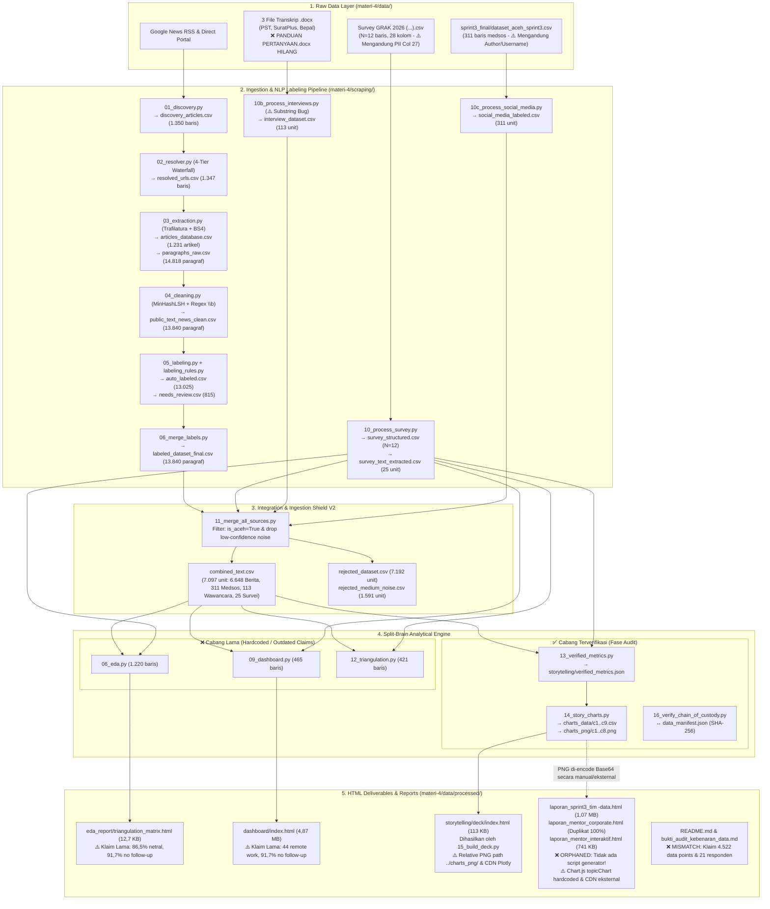

# Laporan Audit End-to-End: Proyek Data Engineering, Analisis & Visualisasi HTML Standalone (`sprint-3`)

**Tanggal Audit:** 29 Oktober 2026  
**Objek Audit:** Repositori `/Users/auliamuzhaffar/Documents/grak/sprint-3` (*GRAK Aceh Startup Ecosystem Intelligence 2026*)  
**Peran Auditor:** Principal Data Engineer, Lead Data Analyst, & Data Visualization Architect  

---

## 1. Executive Summary & Scorecard

Secara keseluruhan, proyek ini memiliki fondasi rekayasa pipeline yang ambisius dan desain antarmuka laporan eksekutif yang impresif secara visual, tetapi **mengalami keretakan integritas data (*split-brain architecture*) antara skrip generasi awal, skrip verifikasi ulang, dokumen pertahanan audit, dan file HTML standalone akhir**.

Upaya mitigasi kualitas data yang dibangun melalui Ingestion Shield V2 ([`11_merge_all_sources.py`](file:///Users/auliamuzhaffar/Documents/grak/sprint-3/materi-4/scraping/11_merge_all_sources.py)), kalkulator metrik terverifikasi ([`13_verified_metrics.py`](file:///Users/auliamuzhaffar/Documents/grak/sprint-3/materi-4/scraping/13_verified_metrics.py)), serta pemeriksa kriptografi SHA-256 ([`16_verify_chain_of_custody.py`](file:///Users/auliamuzhaffar/Documents/grak/sprint-3/materi-4/scraping/16_verify_chain_of_custody.py)) dirusak oleh tiga masalah struktural utama:
1. **Orphaned Deliverable (Putusnya Generator ke Deliverable Utama):** File deliverable utama [`laporan_sprint3_tim -data.html`](file:///Users/auliamuzhaffar/Documents/grak/sprint-3/materi-4/data/processed/laporan_sprint3_tim%20-data.html) (beserta duplikat identiknya [`laporan_mentor_corporate.html`](file:///Users/auliamuzhaffar/Documents/grak/sprint-3/materi-4/data/processed/laporan_mentor_corporate.html)) **tidak dihasilkan oleh skrip Python mana pun di dalam repositori**. Sementara itu, skrip [`15_build_deck.py`](file:///Users/auliamuzhaffar/Documents/grak/sprint-3/materi-4/scraping/15_build_deck.py) hanya menghasilkan [`storytelling/deck/index.html`](file:///Users/auliamuzhaffar/Documents/grak/sprint-3/materi-4/data/processed/storytelling/deck/index.html).
2. **Split-Brain Metrics & Hardcoded Discrepancies:** Skrip lama ([`06_eda.py`](file:///Users/auliamuzhaffar/Documents/grak/sprint-3/materi-4/scraping/06_eda.py), [`09_dashboard.py`](file:///Users/auliamuzhaffar/Documents/grak/sprint-3/materi-4/scraping/09_dashboard.py), [`12_triangulation.py`](file:///Users/auliamuzhaffar/Documents/grak/sprint-3/materi-4/scraping/12_triangulation.py)) masih mencetak klaim lama yang telah dibantah oleh audit internal sendiri (`86,5%` sentimen netral, `91,7%` inkubasi tanpa *follow-up*, `44` keluhan *remote work*), sementara [`README.md`](file:///Users/auliamuzhaffar/Documents/grak/sprint-3/README.md#L12-L16) dan [`bukti_audit_kebenaran_data.md`](file:///Users/auliamuzhaffar/Documents/grak/sprint-3/materi-4/data/processed/bukti_audit_kebenaran_data.md#L25-L42) mengklaim total **4.522 data points** (`21 responden survei`), bertabrakan langsung dengan dataset aktual **7.097 unit teks** dan **12 responden survei**.
3. **Kegagalan Chain of Custody Aktual & Kebocoran PII di Repo:** Eksekusi langsung [`16_verify_chain_of_custody.py`](file:///Users/auliamuzhaffar/Documents/grak/sprint-3/materi-4/scraping/16_verify_chain_of_custody.py) saat ini berstatus **`FAIL` (Exit Code 1)** karena 1 file sumber di manifest hilang dari disk, dan file CSV survei mentah yang tersimpan di repositori masih memuat **8 nomor WhatsApp/email aktif milik responden**.

### Tabel Scorecard Audit

| Pilar Audit | Skor (0–100) | Grade | Status | Ringkasan Penilaian Objektif |
| :--- | :---: | :---: | :---: | :--- |
| **1. Data Engineering (Pipeline & Pemrosesan)** | **72 / 100** | **B-** | ⚠️ *Needs Fix* | Deduplikasi `MinHashLSH`, *waterfall resolver* 4-lapis, dan *Ingestion Shield V2* dirancang baik. Namun terdapat *global thread-lock sleep bug* di HTTP client, inkonsistensi regex `\b` pada skrip wawancara, serta target `Makefile` yang melompati 4 skrip prasyarat. |
| **2. Metodologi & Akurasi Data Analysis** | **64 / 100** | **C** | 🔴 *At Risk* | Rekonsiliasi di [`13_verified_metrics.py`](file:///Users/auliamuzhaffar/Documents/grak/sprint-3/materi-4/scraping/13_verified_metrics.py) sudah jujur secara statistik ($N=12$ menggunakan *Wilcoxon signed-rank*), tetapi terjadi kontradiksi angka yang parah antar dokumen (`4.522` vs `7.097`, denominator *follow-up* `3/5` vs `4/5` vs `4/6` vs `91,7%`, serta `1,8 juta` *web visits* yang diklaim sebagai *users*). |
| **3. Output HTML Standalone (Visual, Narasi & Performa)** | **68 / 100** | **C+** | ⚠️ *Needs Fix* | Desain UI/UX [`laporan_sprint3_tim -data.html`](file:///Users/auliamuzhaffar/Documents/grak/sprint-3/materi-4/data/processed/laporan_sprint3_tim%20-data.html) sangat rapi dengan gambar PNG *base64*, tetapi **bukan 100% standalone** (bergantung CDN `Chart.js`, `AOS`, `FontAwesome`), memuat data `Chart.js` yang di-*hardcode* dan tidak cocok dengan CSV, serta [`deck/index.html`](file:///Users/auliamuzhaffar/Documents/grak/sprint-3/materi-4/data/processed/storytelling/deck/index.html) memiliki *relative image path* yang rusak jika dipindah. |
| **4. Kualitas Kode & Arsitektur Generator** | **58 / 100** | **D+** | 🔴 *At Risk* | Pelanggaran berat *Separation of Concerns*: ribuan baris HTML/CSS/JS di-*hardcode* via *Python f-string* tanpa *template engine* (Jinja2). Deliverable HTML utama tidak memiliki skrip generator, dan terdapat duplikasi skrip warisan (`02_extraction.py` vs `03_extraction.py`, `03_cleaning.py` vs `04_cleaning.py`). |
| **5. Keamanan & Privasi Data (Security & Privacy)** | **65 / 100** | **C** | 🔴 *At Risk* | Tidak ada kebocoran API key dan PII sudah dibuang dari `survey_structured.csv` serta HTML akhir. Namun file mentah survei berisi **8 nomor WhatsApp/email aktif** dan `dataset_aceh_sprint3.csv` berisi **236 nama/username akun medsos** masih tersimpan telanjang di dalam direktori kerja repositori. |
| **SKOR TOTAL (RATA-RATA TERTIMBANG)** | **65,4 / 100** | **C** | ⚠️ **CONDITIONAL PASS (Wajib Remediasi)** | **Layak dipresentasikan secara visual, namun rentan gugur saat uji forensik data jika ketidaksinkronan angka dan generator HTML tidak segera disatukan.** |

---

## 2. Peta Alur Data ke HTML (Data Lineage)

Diagram berikut memetakan arsitektur aktual di repositori dari sumber mentah hingga menjadi 6 file HTML akhir, sekaligus menyoroti titik terjadinya **Split-Brain (percabangan metrik lama vs baru)** dan **Orphaned HTML (file HTML tanpa skrip generator)**.



---

## 3. Temuan Audit per Pilar (Deep-Dive Findings)

### Pilar 1: Audit Data Engineering (Pipeline & Pemrosesan Data)

#### Kekuatan (Strengths)
1. **Arsitektur Resolver & Ekstraksi Tangguh:** [`02_resolver.py`](file:///Users/auliamuzhaffar/Documents/grak/sprint-3/materi-4/scraping/02_resolver.py#L43-L195) mengimplementasikan *4-Tier Waterfall* (Base64 protobuf decoding → HTTP Redirect → Google `batchexecute` API → Playwright headless fallback), dan [`03_extraction.py`](file:///Users/auliamuzhaffar/Documents/grak/sprint-3/materi-4/scraping/03_extraction.py#L429-L435) memiliki mekanisme *checkpointing* tiap 20 artikel sehingga proses *scraping* bersifat *resumable*.
2. **Near-Duplicate Detection & Word-Boundary Regex pada Berita:** [`04_cleaning.py`](file:///Users/auliamuzhaffar/Documents/grak/sprint-3/materi-4/scraping/04_cleaning.py#L140-L163) menggunakan `MinHashLSH` (`threshold=0.8`, `num_perm=128`) di [`lib/dedup.py`](file:///Users/auliamuzhaffar/Documents/grak/sprint-3/materi-4/scraping/lib/dedup.py#L31-L97) untuk mengeliminasi berita sindikasi yang mirip, serta memakai regex batas kata `\b` (`r'\b' + re.escape(kw) + r'\b'`) sehingga kata kunci pendek seperti `"usk"` atau `"it"` tidak memicu *false positive* pada kata `"diskusi"` atau `"kita"`.
3. **Proteksi Label Manual & Ingestion Shield V2:** [`05_labeling.py`](file:///Users/auliamuzhaffar/Documents/grak/sprint-3/materi-4/scraping/05_labeling.py#L384-L450) memproteksi label manual di `needs_review.csv` menggunakan pencocokan `paragraph_id` / MD5 teks dan membuat cadangan `.bak` sebelum menimpa file. [`11_merge_all_sources.py`](file:///Users/auliamuzhaffar/Documents/grak/sprint-3/materi-4/scraping/11_merge_all_sources.py#L118-L164) memfilter *noise* nasional (`7.192` baris ke `rejected_dataset.csv`) secara transparan.

#### Kelemahan & Bug Teknis (Weaknesses)
1. 🔴 **Bug Concurrency (Global Lock saat `time.sleep`) di HTTP Client:**  
   Pada [`lib/http_client.py:134-143`](file:///Users/auliamuzhaffar/Documents/grak/sprint-3/materi-4/scraping/lib/http_client.py#L134-L143), fungsi `_wait_for_rate_limit(domain)` menahan `with self._lock:` global **selama mengeksekusi `time.sleep(wait_time)`**. Akibatnya, ketika `ThreadPoolExecutor(max_workers=5)` di [`03_extraction.py:409`](file:///Users/auliamuzhaffar/Documents/grak/sprint-3/materi-4/scraping/03_extraction.py#L409) berjalan, satu domain yang terkena jeda *rate-limit* akan membekukan seluruh *worker thread* untuk domain lainnya.
2. 🔴 **Inkonsistensi Pencocokan Kata Kunci (Substring Trap) di Skrip Wawancara:**  
   Berbeda dengan [`05_labeling.py:217-222`](file:///Users/auliamuzhaffar/Documents/grak/sprint-3/materi-4/scraping/05_labeling.py#L217-L222) yang sudah menggunakan fungsi `matches_keyword()` berbasis `\b` regex, fungsi `classify_interview_unit()` di [`10b_process_interviews.py:252-270`](file:///Users/auliamuzhaffar/Documents/grak/sprint-3/materi-4/scraping/10b_process_interviews.py#L252-L270) masih menggunakan pencarian *substring* mentah (`if kw in text_lower:`). Karena daftar kata kunci di [`labeling_rules.py:92-123`](file:///Users/auliamuzhaffar/Documents/grak/sprint-3/materi-4/scraping/labeling_rules.py#L92-L123) memuat kata pendek seperti `"it"`, `"uang"`, `"dana"`, dan `"beli"`, pencocokan *substring* mentah pada teks wawancara memicu *false positive* (misal: `"kita"`/`"sulit"` cocok dengan `"it"`, `"peluang"`/`"ruang"` cocok dengan `"uang"`).
3. 🔴 **Orkestrasi `Makefile` Cacat (Melompati 4 Skrip Pipeline):**  
   Target `merge` / `phase3_5` di [`Makefile:111-125`](file:///Users/auliamuzhaffar/Documents/grak/sprint-3/Makefile#L111-L125) dan [`materi-4/scraping/Makefile:95-102`](file:///Users/auliamuzhaffar/Documents/grak/sprint-3/materi-4/scraping/Makefile#L95-L102) langsung menjalankan `11_merge_all_sources.py`, `06_eda.py`, dan `12_triangulation.py` **tanpa menjalankan** `06_merge_labels.py`, `10_process_survey.py`, `10b_process_interviews.py`, dan `10c_process_social_media.py`. Lebih buruk lagi, target untuk `13_verified_metrics.py`, `14_story_charts.py`, `15_build_deck.py`, dan `16_verify_chain_of_custody.py` sama sekali belum terdaftar di kedua `Makefile`.
4. 🔴 **Chain of Custody Gagal (`STATUS: FAIL`) saat Diverifikasi Aktual:**  
   Menjalankan [`16_verify_chain_of_custody.py`](file:///Users/auliamuzhaffar/Documents/grak/sprint-3/materi-4/scraping/16_verify_chain_of_custody.py) menghasilkan *exit code* `1` karena file `materi-4/data/PANDUAN PERTANYAAN INTERVIEW.docx` yang terdaftar sebagai `raw_source` di [`data_manifest.json:36-41`](file:///Users/auliamuzhaffar/Documents/grak/sprint-3/materi-4/data/processed/data_manifest.json#L36-L41) tidak ditemukan di disk.
5. 🟠 **Silent Hardcoded Fallbacks pada Skrip Verifikasi:**  
   Di [`13_verified_metrics.py:50-56`](file:///Users/auliamuzhaffar/Documents/grak/sprint-3/materi-4/scraping/13_verified_metrics.py#L50-L56), apabila file CSV hulu (`discovery_articles.csv`, `resolved_urls.csv`, `articles_database.csv`) tidak ditemukan, skrip tidak menghentikan eksekusi (`raise FileNotFoundError`), melainkan diam-diam mengisi angka *hardcode* (`else 1350`, `else 1347`, `else 1231`).
6. 🟠 **Iterasi `df.iterrows()` yang Lambat:**  
   [`05_labeling.py:328`](file:///Users/auliamuzhaffar/Documents/grak/sprint-3/materi-4/scraping/05_labeling.py#L328) melakukan *looping* `df.iterrows()` pada 13.840 baris dan mengeksekusi ratusan regex per baris secara sekuensial.

---

### Pilar 2: Audit Metodologi & Akurasi Data Analysis

#### Kekuatan (Strengths)
1. **Koreksi Statistik Jujur pada `13_verified_metrics.py`:**  
   Penggunaan uji non-parametrik *Wilcoxon signed-rank test* ($\mu_0 = 3{,}0$) dan *Bootstrap 95% Confidence Interval* (2.000 iterasi, `seed=42`) di [`06_eda.py:362-415`](file:///Users/auliamuzhaffar/Documents/grak/sprint-3/materi-4/scraping/06_eda.py#L362-L415) serta pemisahan ukuran sampel artikel unik ($N=900$) vs paragraf ($N=6.648$) di [`13_verified_metrics.py:114-142`](file:///Users/auliamuzhaffar/Documents/grak/sprint-3/materi-4/scraping/13_verified_metrics.py#L114-L142) menunjukkan kedewasaan metodologi statistik untuk sampel kecil ($N=12$).
2. **Reformulasi Abduktif ($H \rightarrow H'$):**  
   Alih-alih memaksakan klaim bahwa semua hipotesis awal didukung 100%, laporan akhir mengadopsi rubrik *Bukti Kuat / Sedang / Indikatif* yang jauh lebih dapat dipertanggungjawabkan secara ilmiah.

#### Kelemahan & Kesalahan Analisis (Weaknesses)
1. 🔴 **Kontradiksi Fatal Volume Dataset di Dokumen Utama (`4.522` vs `7.097`):**  
   - [`README.md:12-16`](file:///Users/auliamuzhaffar/Documents/grak/sprint-3/README.md#L12-L16) dan [`bukti_audit_kebenaran_data.md:25-42`](file:///Users/auliamuzhaffar/Documents/grak/sprint-3/materi-4/data/processed/bukti_audit_kebenaran_data.md#L25-L42) mendeklarasikan bahwa *Golden Dataset* berjumlah **4.522 data points** yang terdiri dari **3.011 artikel berita**, **1.487 postingan media sosial**, **21 responden survei**, dan **3 transkrip wawancara**.  
   - Faktanya, di seluruh CSV hasil pipeline ([`combined_text.csv`](file:///Users/auliamuzhaffar/Documents/grak/sprint-3/materi-4/data/processed/combined_text.csv), [`verified_metrics.json:7-21`](file:///Users/auliamuzhaffar/Documents/grak/sprint-3/materi-4/data/processed/storytelling/verified_metrics.json#L7-L21)), total data adalah **7.097 unit teks** (**6.648 paragraf berita** dari **900 artikel unik**, **311 unit medsos**, **113 unit wawancara**, dan **25 unit teks survei** dari **12 responden survei**). Bahkan di dalam [`bukti_audit_kebenaran_data.md`](file:///Users/auliamuzhaffar/Documents/grak/sprint-3/materi-4/data/processed/bukti_audit_kebenaran_data.md) sendiri terjadi tabrakan internal: Bagian 1.1 (baris 25–42) menulis `21 responden` dan `4.522 data points`, tetapi Bagian 2.3 (baris 97) menulis `12 responden (N=12)`!
2. 🔴 **Kekacauan Denominator Metrik "Inkubasi Tanpa Follow-up" (4 Angka Berbeda untuk 1 Metrik):**  
   Dalam [`survey_structured.csv`](file:///Users/auliamuzhaffar/Documents/grak/sprint-3/materi-4/data/processed/survey_structured.csv) ($N=12$), terdapat **5 responden** yang menjawab `"Ya"` pada `pernah_inkubasi`, namun terdapat **6 responden** yang mengisi kolom `followup_program` (4 menjawab `"Tidak ada sama sekali"`, 1 `"Ada, tapi terbatas"`, 1 `"Ada, berkelanjutan"`). Akibat tidak adanya kesepakatan denominator di kode:
   - [`12_triangulation.py:125`](file:///Users/auliamuzhaffar/Documents/grak/sprint-3/materi-4/scraping/12_triangulation.py#L125) & [`09_dashboard.py:424`](file:///Users/auliamuzhaffar/Documents/grak/sprint-3/materi-4/scraping/09_dashboard.py#L424) menulis **`91,7%`** (angka halusinasi `11/12` dari draf lama).
   - [`bukti_audit_kebenaran_data.md:107`](file:///Users/auliamuzhaffar/Documents/grak/sprint-3/materi-4/data/processed/bukti_audit_kebenaran_data.md#L107) menulis **`80,0% (4 dari 5)`**.
   - [`13_verified_metrics.py:278`](file:///Users/auliamuzhaffar/Documents/grak/sprint-3/materi-4/scraping/13_verified_metrics.py#L278) menulis **`"3/5 alumni inkubasi tanpa tindak lanjut"`** (`60,0%`).
   - [`14_story_charts.py:418`](file:///Users/auliamuzhaffar/Documents/grak/sprint-3/materi-4/scraping/14_story_charts.py#L418), [`15_build_deck.py:547`](file:///Users/auliamuzhaffar/Documents/grak/sprint-3/materi-4/scraping/15_build_deck.py#L547), dan [`laporan_sprint3_tim -data.html:2603`](file:///Users/auliamuzhaffar/Documents/grak/sprint-3/materi-4/data/processed/laporan_sprint3_tim%20-data.html#L2603) menulis **`66,7% (4 dari 6)`**, tetapi pada catatan metodologi di [`laporan_sprint3_tim -data.html:2674`](file:///Users/auliamuzhaffar/Documents/grak/sprint-3/materi-4/data/processed/laporan_sprint3_tim%20-data.html#L2674) tertulis **`(N=6 dari 15 founder disurvei)`**!
3. 🔴 **Distorsi Metrik Traksi SuratPlus (`1,8 Juta Visits` Ditulis Sebagai `1,8 Juta Pengguna`):**  
   Di [`bukti_audit_kebenaran_data.md:80-83`](file:///Users/auliamuzhaffar/Documents/grak/sprint-3/materi-4/data/processed/bukti_audit_kebenaran_data.md#L80-L83), telah diklarifikasi berdasarkan transkrip wawancara bahwa SuratPlus memiliki **200.000+ pengguna terdaftar (*registered users*)** dan **1,8 juta kunjungan web (*web visits*)**. Namun di [`laporan_sprint3_tim -data.html:2772,2886,3070`](file:///Users/auliamuzhaffar/Documents/grak/sprint-3/materi-4/data/processed/laporan_sprint3_tim%20-data.html#L2772), [`15_build_deck.py:602`](file:///Users/auliamuzhaffar/Documents/grak/sprint-3/materi-4/scraping/15_build_deck.py#L602), dan [`final_report.md:84`](file:///Users/auliamuzhaffar/Documents/grak/sprint-3/materi-4/data/processed/final_report.md#L84), angka tersebut masih ditulis sebagai **"1,8 Juta Pengguna di 250 Kota"**. Dalam analisis bisnis SaaS, menyamakan *pageviews/visits* dengan *registered users* adalah kesalahan definisi KPI yang fatal (inflasi $9\times$).
4. 🟠 **Inkonsistensi Fakta Studi Kasus PST (Produk & Tahun Hibah):**  
   [`bukti_audit_kebenaran_data.md:67-71`](file:///Users/auliamuzhaffar/Documents/grak/sprint-3/materi-4/data/processed/bukti_audit_kebenaran_data.md#L67-L71) menyatakan hibah PST terjadi pada **2023** dengan produk **mangkuk dan wadah bioplastik pati sagu** (bukan sedotan). Namun [`15_build_deck.py:530,812`](file:///Users/auliamuzhaffar/Documents/grak/sprint-3/materi-4/scraping/15_build_deck.py#L530) dan [`final_report.md:72`](file:///Users/auliamuzhaffar/Documents/grak/sprint-3/materi-4/data/processed/final_report.md#L72) masih menyebutkan **"penjualan sedotan & kantong"** dan **"vakum sejak 2022"**.

---

### Pilar 3: Audit Output HTML Standalone (Visualisasi, Narasi & Performa)

Di dalam repositori terdapat **6 file HTML output** di [`materi-4/data/processed/`](file:///Users/auliamuzhaffar/Documents/grak/sprint-3/materi-4/data/processed/):
1. [`laporan_sprint3_tim -data.html`](file:///Users/auliamuzhaffar/Documents/grak/sprint-3/materi-4/data/processed/laporan_sprint3_tim%20-data.html) (`1,07 MB`, `3.537 baris`) — Deliverable utama eksekutif.
2. [`laporan_mentor_corporate.html`](file:///Users/auliamuzhaffar/Documents/grak/sprint-3/materi-4/data/processed/laporan_mentor_corporate.html) (`1,07 MB`, `3.537 baris`) — **100% duplikat byte-for-byte** dari `laporan_sprint3_tim -data.html`.
3. [`laporan_mentor_interaktif.html`](file:///Users/auliamuzhaffar/Documents/grak/sprint-3/materi-4/data/processed/laporan_mentor_interaktif.html) (`741 KB`, `382 baris`) — Versi ringkas laporan mentor.
4. [`storytelling/deck/index.html`](file:///Users/auliamuzhaffar/Documents/grak/sprint-3/materi-4/data/processed/storytelling/deck/index.html) (`113 KB`, `1.528 baris`) — Dihasilkan oleh [`15_build_deck.py`](file:///Users/auliamuzhaffar/Documents/grak/sprint-3/materi-4/scraping/15_build_deck.py).
5. [`dashboard/index.html`](file:///Users/auliamuzhaffar/Documents/grak/sprint-3/materi-4/data/processed/dashboard/index.html) (`4,87 MB`, `3.991 baris`) — Dihasilkan oleh [`09_dashboard.py`](file:///Users/auliamuzhaffar/Documents/grak/sprint-3/materi-4/scraping/09_dashboard.py).
6. [`eda_report/triangulation_matrix.html`](file:///Users/auliamuzhaffar/Documents/grak/sprint-3/materi-4/data/processed/eda_report/triangulation_matrix.html) (`12,7 KB`, `199 baris`) — Dihasilkan oleh [`06_eda.py`](file:///Users/auliamuzhaffar/Documents/grak/sprint-3/materi-4/scraping/06_eda.py).

#### Kekuatan (Strengths)
1. **Kualitas Visual Storytelling & Hirarki Informasi:**  
   Pemilihan jenis grafik di [`14_story_charts.py`](file:///Users/auliamuzhaffar/Documents/grak/sprint-3/materi-4/scraping/14_story_charts.py) (Dotplot Likert dengan garis batas netral `3,0`, Waffle Chart $10/12$ pendanaan, Horizontal Diverging/Contrast Bar sentimen lintas sumber, dan Heatmap ternormalisasi per baris) sangat tepat untuk ukuran sampel kecil dan mudah dipahami eksekutif.
2. **Enkapsulasi Gambar Base64 pada Laporan Utama:**  
   Kelima grafik PNG di [`laporan_sprint3_tim -data.html`](file:///Users/auliamuzhaffar/Documents/grak/sprint-3/materi-4/data/processed/laporan_sprint3_tim%20-data.html) sudah di-*embed* sebagai string `data:image/png;base64,...` dengan ukuran file total yang masih rasional (`1,07 MB`) dan tanpa membocorkan *array* data mentah ribuan baris ke dalam DOM.

#### Kelemahan & Cacat Implementasi HTML (Weaknesses)
1. 🔴 **Ketidaksinkronan Data Grafik `Chart.js` (`#topicChart`) di dalam HTML Utama:**  
   Pada [`laporan_sprint3_tim -data.html:2534`](file:///Users/auliamuzhaffar/Documents/grak/sprint-3/materi-4/data/processed/laporan_sprint3_tim%20-data.html#L2534) dan blok inisialisasi JavaScript di [`laporan_sprint3_tim -data.html:3469-3494`](file:///Users/auliamuzhaffar/Documents/grak/sprint-3/materi-4/data/processed/laporan_sprint3_tim%20-data.html#L3469-L3494) (serta [`laporan_mentor_interaktif.html:346-360`](file:///Users/auliamuzhaffar/Documents/grak/sprint-3/materi-4/data/processed/laporan_mentor_interaktif.html#L346-L360)), terdapat grafik interaktif `Chart.js` dengan 6 batang yang di-*hardcode*:
   - `'UMKM Digital': 23.0%`
   - `'Kredit / KUR Bank': 15.3%`
   - `'Kebutuhan Talenta': 14.9%`
   - `'Regulasi / Dinas': 10.9%`
   - `'Infrastruktur Fisik': 6.5%` *(Salah label! Di [`c7_news_topic_framing.csv`](file:///Users/auliamuzhaffar/Documents/grak/sprint-3/materi-4/data/processed/storytelling/charts_data/c7_news_topic_framing.csv), angka `6,5%` / `432 paragraf` adalah milik **Ekosistem & Komunitas**, bukan Infrastruktur Fisik)*
   - `'Deep-Tech & R&D': 2.4%`  
   Selain kesalahan pelabelan `6,5%` di atas, grafik ini memotong 2 kategori dari 8 topik terverifikasi di [`c7_news_topic_framing.csv`](file:///Users/auliamuzhaffar/Documents/grak/sprint-3/materi-4/data/processed/storytelling/charts_data/c7_news_topic_framing.csv) dan [`verified_metrics.json`](file:///Users/auliamuzhaffar/Documents/grak/sprint-3/materi-4/data/processed/storytelling/verified_metrics.json), yaitu **Akses Pasar (`9,5%` / `632 paragraf`)** dan **Kisah Sukses (`5,3%` / `354 paragraf`)** (di luar `815 paragraf` / `12,3%` *unclassified `needs_review`* yang digabungkan ke `ecosystem` pada C8 Heatmap menjadi `18,8%`).
2. 🔴 **File HTML Tidak Benar-Benar *Standalone* (Masalah Offline & Portabilitas):**  
   - **Ketergantungan CDN Eksternal di [`laporan_sprint3_tim -data.html:10-16,3036`](file:///Users/auliamuzhaffar/Documents/grak/sprint-3/materi-4/data/processed/laporan_sprint3_tim%20-data.html#L10-L16):** Memuat `Chart.js`, `AOS (Animate On Scroll) CSS/JS`, `FontAwesome 6.4.0`, dan `Google Fonts` dari internet. Lebih berbahaya lagi, elemen `<section data-aos="fade-up">` menggunakan CSS bawaan AOS (`opacity: 0` jika CSS AOS termuat tetapi JS gagal dieksekusi atau terblokir), serta grafik `#topicChart` dan seluruh ikon `<i class="fa-solid ...">` akan hilang jika dibuka *offline*.
   - **Broken Relative Image Paths di [`storytelling/deck/index.html:727,1081`](file:///Users/auliamuzhaffar/Documents/grak/sprint-3/materi-4/data/processed/storytelling/deck/index.html#L727) ([`15_build_deck.py:311,787`](file:///Users/auliamuzhaffar/Documents/grak/sprint-3/materi-4/scraping/15_build_deck.py#L311)):** Menggunakan `` dan ``, ditambah `<script src="https://cdn.plot.ly/plotly-2.35.2.min.js">`. Jika file `index.html` ini dikirimkan secara terpisah tanpa folder `../charts_png/`, kedua gambar utama tersebut langsung *broken*.
3. 🟠 **Pembengkakan Ukuran File (`4,87 MB`) & Klaim Usang pada `dashboard/index.html`:**  
   [`09_dashboard.py:212`](file:///Users/auliamuzhaffar/Documents/grak/sprint-3/materi-4/scraping/09_dashboard.py#L212) menyematkan seluruh *library* `plotly.min.js` (`~4,6 MB`) secara *inline*, namun teks narasi di dalamnya ([`09_dashboard.py:392-447`](file:///Users/auliamuzhaffar/Documents/grak/sprint-3/materi-4/scraping/09_dashboard.py#L392-L447)) masih menampilkan klaim yang sudah dibatalkan oleh tim sendiri (`91,7%` inkubasi tanpa *follow-up*, `86,5%` sentimen netral, `44` keluhan *remote work*).

---

### Pilar 4: Kualitas Kode & Arsitektur Generator (Maintainability)

#### Kekuatan (Strengths)
1. **Konfigurasi Tersentralisasi & Logging Terstruktur:**  
   [`config.py`](file:///Users/auliamuzhaffar/Documents/grak/sprint-3/materi-4/scraping/config.py) mendefinisikan *path* dan parameter secara rapi, sementara [`lib/logger.py`](file:///Users/auliamuzhaffar/Documents/grak/sprint-3/materi-4/scraping/lib/logger.py) mencatat log berformat JSONL yang memudahkan *debugging* proses *scraping*.

#### Kelemahan & Utang Teknis Arsitektur (Weaknesses)
1. 🔴 **Deliverable HTML Utama Bersifat *Orphaned* (Tidak Dapat Direproduksi dari Kode):**  
   Tidak ada satu pun skrip di [`materi-4/scraping/`](file:///Users/auliamuzhaffar/Documents/grak/sprint-3/materi-4/scraping/) yang menghasilkan [`laporan_sprint3_tim -data.html`](file:///Users/auliamuzhaffar/Documents/grak/sprint-3/materi-4/data/processed/laporan_sprint3_tim%20-data.html), [`laporan_mentor_corporate.html`](file:///Users/auliamuzhaffar/Documents/grak/sprint-3/materi-4/data/processed/laporan_mentor_corporate.html), maupun [`laporan_mentor_interaktif.html`](file:///Users/auliamuzhaffar/Documents/grak/sprint-3/materi-4/data/processed/laporan_mentor_interaktif.html). Apabila terdapat pembaruan data survei atau perbaikan klasifikasi berita, ketiga file HTML ini tidak dapat di-*build* ulang secara otomatis.
2. 🟠 **Spaghetti HTML Generation (Ribuan Baris HTML di dalam String Python):**  
   Skrip [`15_build_deck.py`](file:///Users/auliamuzhaffar/Documents/grak/sprint-3/materi-4/scraping/15_build_deck.py) (`1.717 baris`), [`06_eda.py`](file:///Users/auliamuzhaffar/Documents/grak/sprint-3/materi-4/scraping/06_eda.py) (`1.220 baris`), dan [`09_dashboard.py`](file:///Users/auliamuzhaffar/Documents/grak/sprint-3/materi-4/scraping/09_dashboard.py) (`465 baris`) mencampuradukkan logika pengolahan data Pandas, pembuatan grafik Plotly/Matplotlib, CSS ratusan baris, dan struktur DOM HTML di dalam satu string Python raksasa tanpa menggunakan *template engine* seperti `Jinja2`.
3. 🟠 **Polusi File Duplikat / Warisan di Direktori Kerja:**  
   - Skrip Python ganda dengan penomoran tumpang tindih: [`02_extraction.py`](file:///Users/auliamuzhaffar/Documents/grak/sprint-3/materi-4/scraping/02_extraction.py) vs [`03_extraction.py`](file:///Users/auliamuzhaffar/Documents/grak/sprint-3/materi-4/scraping/03_extraction.py), serta [`03_cleaning.py`](file:///Users/auliamuzhaffar/Documents/grak/sprint-3/materi-4/scraping/03_cleaning.py) vs [`04_cleaning.py`](file:///Users/auliamuzhaffar/Documents/grak/sprint-3/materi-4/scraping/04_cleaning.py).
   - File CSV identik berukuran `7,6 MB` yang disimpan 3 kali: `materi-4/data/public_text_news_clean.csv`, `materi-4/data/processed/public_text_news_clean.csv`, `materi-4/data/processed/labeled_dataset.csv`, dan `materi-4/data/processed/labeled_dataset_final.csv`.
   - File HTML identik `1,07 MB` disimpan 2 kali: `laporan_sprint3_tim -data.html` (dengan spasi sebelum tanda hubung pada nama file!) dan `laporan_mentor_corporate.html`.
   - Dua file `Makefile` berbeda ([`./Makefile`](file:///Users/auliamuzhaffar/Documents/grak/sprint-3/Makefile) dan [`./materi-4/scraping/Makefile`](file:///Users/auliamuzhaffar/Documents/grak/sprint-3/materi-4/scraping/Makefile)).

---

### Pilar 5: Keamanan & Privasi Data (Security & Data Leakage)

#### Kekuatan (Strengths)
1. **Sanitasi PII pada Output Terproses & HTML Akhir:**  
   [`10_process_survey.py:135-145`](file:///Users/auliamuzhaffar/Documents/grak/sprint-3/materi-4/scraping/10_process_survey.py#L135-L145) secara eksplisit membuang kolom ke-27 (`Nomor WhatsApp atau Email yang dapat dihubungi`) saat membentuk `survey_structured.csv`. Hasil pemindaian otomatis terhadap seluruh 8 nilai PII responden membuktikan **0 kebocoran PII di dalam seluruh file HTML dan CSV di `materi-4/data/processed/`**.
2. **Bebas Hardcoded Credentials:**  
   Tidak ditemukan API key, token rahasia, atau password yang di-*hardcode* di seluruh skrip Python.

#### Kelemahan & Risiko Privasi (Weaknesses)
1. 🔴 **Penyimpanan Data Mentah Berisi PII Aktif (Nomor WhatsApp & Email) di Repositori:**  
   File [`materi-4/data/Survey GRAK 2026 - Sprint 3 (Responses) - Form Responses 1.csv`](file:///Users/auliamuzhaffar/Documents/grak/sprint-3/materi-4/data/Survey%20GRAK%202026%20-%20Sprint%203%20(Responses)%20-%20Form%20Responses%201.csv) memuat **8 nomor WhatsApp dan alamat email pribadi milik founder/responden** pada kolom terakhir (`Col 27`), dan file ini tidak dimasukkan ke dalam [`.gitignore`](file:///Users/auliamuzhaffar/Documents/grak/sprint-3/.gitignore) (bahkan dikunci di [`data_manifest.json:14-19`](file:///Users/auliamuzhaffar/Documents/grak/sprint-3/materi-4/data/processed/data_manifest.json#L14-L19)). Jika repositori ini di-*push* ke GitHub publik, data kontak pribadi responden akan bocor secara permanen di riwayat Git.
2. 🟠 **Eksposur Nama Lengkap & Username Akun Media Sosial:**  
   File [`materi-4/data/sprint3_final/dataset_aceh_sprint3.csv`](file:///Users/auliamuzhaffar/Documents/grak/sprint-3/materi-4/data/sprint3_final/dataset_aceh_sprint3.csv) menyimpan kolom `author` dan `username` dari **236 akun individu** tanpa anonimisasi (*hashing/masking*). Selain itu, [`data_manifest.json:4`](file:///Users/auliamuzhaffar/Documents/grak/sprint-3/materi-4/data/processed/data_manifest.json#L4) mengekspos *absolute path* mesin lokal (`/Users/auliamuzhaffar/Documents/grak/sprint-3`).

---

## 4. Cek Konsistensi: Pipeline vs Output HTML

Tabel berikut membandingkan angka *Ground Truth* (hasil perhitungan langsung dari CSV & [`verified_metrics.json`](file:///Users/auliamuzhaffar/Documents/grak/sprint-3/materi-4/data/processed/storytelling/verified_metrics.json)) dengan yang tertulis di berbagai artefak proyek:

| Metrik / Klaim | Ground Truth (`combined_text.csv` & `verified_metrics.json`) | `README.md` & `bukti_audit_kebenaran_data.md` | `12_triangulation.py` / `09_dashboard.py` (`dashboard/index.html`) | `15_build_deck.py` (`storytelling/deck/index.html`) | `laporan_sprint3_tim -data.html` (Deliverable Utama) | Status Konsistensi |
| :--- | :--- | :--- | :--- | :--- | :--- | :---: |
| **Total Korpus Gabungan (`combined_text.csv`)** | **7.097 unit teks** | ❌ **4.522 data points** (`README.md:12`, `bukti_audit:25`) | ✅ 7.097 unit | ✅ 7.097 unit | ✅ 7.097 unit | 🔴 **MISMATCH** |
| **Volume Data Berita** | **6.648 paragraf** (dari **900 artikel unik**; 1.231 diekstrak; 13.840 pra-filter) | ❌ **3.011 artikel berita** (`README.md:13`, `bukti_audit:32`) | ⚠️ Mencampur `6.648` & `13.840` | ✅ 6.648 paragraf (900 artikel) | ✅ 6.648 paragraf (900 artikel) | 🔴 **MISMATCH** |
| **Volume Data Media Sosial** | **311 unit** | ❌ **1.487 postingan** (`README.md:14`, `bukti_audit:35`) | ✅ 311 unit | ✅ 311 unit | ✅ 311 unit | 🔴 **MISMATCH** |
| **Jumlah Responden Survei ($N$)** | **$N = 12$ responden** (25 unit teks terbuka) | ❌ **21 responden** (`README.md:15`, `bukti_audit:39`) vs **12 responden** (`bukti_audit:97`) | ✅ $N = 12$ | ✅ $N = 12$ | ⚠️ Tertulis **$N = 12$**, namun di `L2674` tertulis **"N=6 dari 15 founder disurvei"** | 🔴 **MISMATCH** |
| **Sentimen Berita (Netral / Negatif)** | **81,21% Netral** / **0,51% Negatif** | ✅ 81,21% Netral (`bukti_audit:151`) | ❌ **86,5% Netral / 0,4% Negatif** (`12_triangulation:177`, `09_dashboard:401`) | ✅ 81,21% Netral / 0,51% Negatif (dan menampilkan 86,5% di tabel koreksi audit) | ✅ 81,2% Netral / 0,51% Negatif | ⚠️ **SPLIT-BRAIN** |
| **Alumni Inkubasi Tanpa Follow-up** | **4 dari 6 (66,7%)** penjawab kolom *follow-up*, atau **4 dari 5 (80,0%)** penjawab `pernah_inkubasi='Ya'` | ⚠️ **80,0% (4 dari 5)** (`bukti_audit:107`) | ❌ **91,7%** (`12_triangulation:284`, `09_dashboard:424`) | ⚠️ **66,7% (4/6)** di slide, tapi di `13_verified_metrics:278` tertulis **"3/5 alumni"** | ✅ **66,7% (4 dari 6)** | 🔴 **MISMATCH** |
| **Distribusi Topik Berita (Grafik C7 vs `#topicChart`)** | Digitalisasi `23,0%` (`1.526`), Pendanaan `15,3%` (`1.017`), Talenta `14,9%` (`988`), Regulasi `10,9%` (`725`), Akses Pasar `9,5%` (`632`), Ekosistem `6,5%` (`432`, atau `18,8%` / `1.247` termasuk `815` *needs_review*), Kisah Sukses `5,3%` (`354`), R&D/Infra `2,4%` (`159`) | N/A | ⚠️ Menggunakan angka pra-filter `13.840` | ✅ Sesuai `c7_news_topic_framing.csv` (8 kategori) | ❌ `Chart.js #topicChart` (`L3482`): Hanya menampilkan 6 kategori dan salah melabeli `6,5%` (*Ekosistem*) sebagai `'Infrastruktur Fisik'` serta menghilangkan *Akses Pasar* (`9,5%`) & *Kisah Sukses* (`5,3%`) | 🔴 **MISMATCH** |
| **Traksi SuratPlus (Wawancara)** | **200.000+ users** & **1,8 juta web visits** di 250 kota | ✅ 200.000+ user & 1,8 juta kunjungan (`bukti_audit:81`) | ❌ "95%+ revenue dari luar Aceh" (`12_triangulation:157`) | ❌ **"1,8 juta pengguna (users)"** (`15_build_deck:602`) | ❌ **"1,8 Juta Pengguna di 250 Kota"** (`L2772`, `L2886`, `L3070`) | 🔴 **MISMATCH** |
| **Studi Kasus PST (Produk & Tahun)** | **Mangkuk & wadah bioplastik sagu** | ⚠️ `bukti_audit:67` menulis **Hibah 2023**, mangkuk & wadah | N/A | ❌ Menulis **"sedotan & kantong"** (`L530`) dan **"vakum sejak 2022"** (`L812`) | ⚠️ Menulis **"mangkuk & wadah"**, hibah berakhir **2021**, **vakum sejak 2022** (`L2607`, `L2694`) | 🟠 **INCONSISTENT** |
| **Keluhan Remote Work & VC Lokal di Medsos** | **9 unit** *remote work*; **34 unit** menyebut VC | N/A | ❌ **44 unit** *remote work*; **45 unit VC lokal nol** (`12_triangulation:201,250`) | ✅ Dikoreksi menjadi 9 unit & 34 unit | ✅ Tidak menggunakan klaim palsu 44/45 unit | ⚠️ **SPLIT-BRAIN** |

---

## 5. Rekomendasi Perbaikan & Refactoring (Before vs After)

Berikut adalah daftar prioritas perbaikan dari yang paling kritis hingga penyempurnaan visual, lengkap dengan potongan kode **Before vs After**.

### 🔴 Prioritas 1 (Critical): Kesalahan Data, Bug Pipeline, & Kebocoran PII

#### 1.1. Perbaikan Substring Trap pada `10b_process_interviews.py`
Gunakan pencocokan berbasis batas kata (`\b`) seperti pada `05_labeling.py` agar kata pendek (`"it"`, `"uang"`, `"dana"`) tidak memicu *false positive* pada transkrip wawancara.

* **Lokasi:** [`materi-4/scraping/10b_process_interviews.py:252-270`](file:///Users/auliamuzhaffar/Documents/grak/sprint-3/materi-4/scraping/10b_process_interviews.py#L252-L270)

```python
# ❌ BEFORE (materi-4/scraping/10b_process_interviews.py:252-270)
    topic_scores = {}
    for cat, kws in TOPIC_KEYWORDS.items():
        score = 0
        for kw in kws:
            if kw in text_lower:
                score += 1
        if score > 0:
            topic_scores[cat] = score
```

```python
# ✅ AFTER (Gunakan word-boundary regex \b yang konsisten dengan 05_labeling.py)
    import re
    topic_scores = {}
    for cat, kws in TOPIC_KEYWORDS.items():
        score = sum(
            1 for kw in kws
            if re.search(r'\b' + re.escape(kw.lower()) + r'\b', text_lower)
        )
        if score > 0:
            topic_scores[cat] = score
```

---

#### 1.2. Perbaikan Global Lock Blocking saat `time.sleep()` di `lib/http_client.py`
Jangan menahan `self._lock` global ketika sedang melakukan `time.sleep()`, atau gunakan *lock* per domain agar *worker thread* untuk portal berita lain tidak ikut membeku.

* **Lokasi:** [`materi-4/scraping/lib/http_client.py:134-143`](file:///Users/auliamuzhaffar/Documents/grak/sprint-3/materi-4/scraping/lib/http_client.py#L134-L143)

```python
# ❌ BEFORE (materi-4/scraping/lib/http_client.py:134-143)
    def _wait_for_rate_limit(self, domain: str):
        """Pastikan jeda antar request ke domain yang sama >= min_delay."""
        with self._lock:
            now = time.time()
            elapsed = now - self._last_request_time[domain]
            min_delay = self._get_delay(domain)
            if elapsed < min_delay:
                wait_time = min_delay - elapsed + random.uniform(0.1, 0.5)
                time.sleep(wait_time)
            self._last_request_time[domain] = time.time()
```

```python
# ✅ AFTER (Hitung jadwal slot di dalam lock, lalu sleep di luar global lock)
    def _wait_for_rate_limit(self, domain: str):
        """Pastikan jeda antar request ke domain yang sama >= min_delay tanpa memblokir domain lain."""
        with self._lock:
            now = time.time()
            min_delay = self._get_delay(domain) + random.uniform(0.1, 0.5)
            next_allowed = max(now, self._last_request_time[domain] + min_delay)
            self._last_request_time[domain] = next_allowed
            wait_time = next_allowed - now

        if wait_time > 0:
            time.sleep(wait_time)
```

---

#### 1.3. Sinkronisasi Data Grafik `Chart.js` (`#topicChart`) pada HTML Utama dengan `verified_metrics.json`
Ganti angka *hardcode* `[23.0, 15.3, 14.9, 10.9, 6.5, 2.4]` di [`laporan_sprint3_tim -data.html:3472-3493`](file:///Users/auliamuzhaffar/Documents/grak/sprint-3/materi-4/data/processed/laporan_sprint3_tim%20-data.html#L3472-L3493) dengan angka terverifikasi dari [`c7_news_topic_framing.csv`](file:///Users/auliamuzhaffar/Documents/grak/sprint-3/materi-4/data/processed/storytelling/charts_data/c7_news_topic_framing.csv) (`N = 6.648` paragraf berita).

* **Lokasi:** [`materi-4/data/processed/laporan_sprint3_tim -data.html:3471-3494`](file:///Users/auliamuzhaffar/Documents/grak/sprint-3/materi-4/data/processed/laporan_sprint3_tim%20-data.html#L3471-L3494)

```javascript
// ❌ BEFORE (laporan_sprint3_tim -data.html:3471-3494)
                    data: {
                        labels: [
                            'UMKM Digital',
                            'Kredit / KUR Bank',
                            'Kebutuhan Talenta',
                            'Regulasi / Dinas',
                            'Infrastruktur Fisik',
                            'Deep-Tech & R&D'
                        ],
                        datasets: [{
                            label: 'Porsi Liputan Berita (%)',
                            data: [23.0, 15.3, 14.9, 10.9, 6.5, 2.4],
                            backgroundColor: ['#CBD5E1', '#CBD5E1', '#CBD5E1', '#CBD5E1', '#CBD5E1', '#E4572E'],
                            borderRadius: 6,
                            barPercentage: 0.65
                        }]
                    },
```

```javascript
// ✅ AFTER (Sinkron 100% dengan 8 kategori di c7_news_topic_framing.csv & verified_metrics.json)
                    data: {
                        labels: [
                            'Digitalisasi UMKM / E-Commerce (1.526)',
                            'Pendanaan / KUR Perbankan (1.017)',
                            'Talenta & Literasi Dasar (988)',
                            'Regulasi & Pemerintah (725)',
                            'Akses Pasar (632)',
                            'Ekosistem & Komunitas (432)',
                            'Kisah Sukses & Profil (354)',
                            'Infrastruktur Teknologi & R&D (159)'
                        ],
                        datasets: [{
                            label: 'Porsi Liputan Berita (% dari 6.648 Paragraf)',
                            data: [23.0, 15.3, 14.9, 10.9, 9.5, 6.5, 5.3, 2.4],
                            backgroundColor: [
                                '#1E3A8A', '#CBD5E1', '#CBD5E1', '#CBD5E1',
                                '#CBD5E1', '#CBD5E1', '#94A3B8', '#E4572E'
                            ],
                            borderRadius: 6,
                            barPercentage: 0.65
                        }]
                    },
```

---

#### 1.4. Sanitasi PII pada File Mentah Survei & Pembaruan `.gitignore`
Sebelum melakukan *commit* ke Git, redaksi kolom ke-27 (`Nomor WhatsApp atau Email yang dapat dihubungi`) pada CSV mentah atau pindahkan file mentah ber-PII ke luar pelacakan Git, lalu perbarui hash di `data_manifest.json`.

* **Lokasi:** [`.gitignore`](file:///Users/auliamuzhaffar/Documents/grak/sprint-3/.gitignore)

```gitignore
# ❌ BEFORE (.gitignore)
# Backup files
*.bak

# Editor settings
.vscode/
```

```gitignore
# ✅ AFTER (.gitignore)
# Backup & temporary files
*.bak
.DS_Store

# Raw files containing PII (WhatsApp / Email / Unmasked Usernames)
materi-4/data/*Survey*Responses*.csv
materi-4/data/*.docx

# Editor & Python cache
.vscode/
__pycache__/
*.pyc
```

---

### 🟠 Prioritas 2 (Medium): Kemandirian HTML Standalone, Orkestrasi Makefile, & Penghapusan Silent Fallback

#### 2.1. Ubah Relative Image Path di `15_build_deck.py` Menjadi Base64 Data URI
Agar [`storytelling/deck/index.html`](file:///Users/auliamuzhaffar/Documents/grak/sprint-3/materi-4/data/processed/storytelling/deck/index.html) benar-benar *standalone* dan gambarnya tidak pecah ketika file HTML dipindahkan sendirian, ubah `` menjadi *Base64 Data URI*.

* **Lokasi:** [`materi-4/scraping/15_build_deck.py:311,787`](file:///Users/auliamuzhaffar/Documents/grak/sprint-3/materi-4/scraping/15_build_deck.py#L311)

```python
# ❌ BEFORE (materi-4/scraping/15_build_deck.py:310-313)
      <div class="card" style="padding:12px; display:flex; flex-direction:column; justify-content:center; background:#FFF;">
        
      </div>
```

```python
# ✅ AFTER (Embed PNG sebagai Base64 agar deck/index.html 100% standalone)
import base64

def encode_png_b64(png_path: str) -> str:
    with open(png_path, "rb") as img_f:
        return "data:image/png;base64," + base64.b64encode(img_f.read()).decode("utf-8")

c1_b64 = encode_png_b64(os.path.join(CHARTS_PNG_DIR, "c1_funnel_pipeline_16_9.png"))
c8_b64 = encode_png_b64(os.path.join(CHARTS_PNG_DIR, "c8_topic_heatmap_16_9.png"))

# Di dalam template HTML:
# 
```

---

#### 2.2. Hapus Silent Hardcoded Fallback di `13_verified_metrics.py`
Jangan memalsukan jumlah baris dengan angka *hardcode* (`1350`, `1347`, `1231`) jika file CSV gagal ditemukan.

* **Lokasi:** [`materi-4/scraping/13_verified_metrics.py:50-56`](file:///Users/auliamuzhaffar/Documents/grak/sprint-3/materi-4/scraping/13_verified_metrics.py#L50-L56)

```python
# ❌ BEFORE (materi-4/scraping/13_verified_metrics.py:50-56)
    n_discovery = len(pd.read_csv(discovery_path)) if os.path.exists(discovery_path) else 1350
    n_resolved = len(pd.read_csv(resolved_path)) if os.path.exists(resolved_path) else 1347
    n_articles = len(pd.read_csv(articles_path)) if os.path.exists(articles_path) else 1231
```

```python
# ✅ AFTER (Fail-fast: hentikan eksekusi jika file input hilang)
    for required_path in (discovery_path, resolved_path, articles_path):
        if not os.path.exists(required_path):
            raise FileNotFoundError(f"File input wajib tidak ditemukan: {required_path}")

    n_discovery = len(pd.read_csv(discovery_path))
    n_resolved = len(pd.read_csv(resolved_path))
    n_articles = len(pd.read_csv(articles_path))
```

---

#### 2.3. Lengkapi Urutan Eksekusi End-to-End di `Makefile`
Perbaiki target `phase3_5` di [`Makefile:111-125`](file:///Users/auliamuzhaffar/Documents/grak/sprint-3/Makefile#L111-L125) agar menjalankan seluruh skrip pemrosesan multi-sumber, verifikasi metrik, pembuatan grafik, pembangunan HTML, hingga audit SHA-256 secara berurutan.

* **Lokasi:** [`Makefile:111-125`](file:///Users/auliamuzhaffar/Documents/grak/sprint-3/Makefile#L111-L125)

```makefile
# ❌ BEFORE (Makefile:111-125)
merge:
	cd $(SCRAPING_DIR) && $(PYTHON) 11_merge_all_sources.py

eda:
	cd $(SCRAPING_DIR) && $(PYTHON) 06_eda.py

triangulate:
	cd $(SCRAPING_DIR) && $(PYTHON) 12_triangulation.py

phase3_5: merge eda triangulate
```

```makefile
# ✅ AFTER (Makefile End-to-End Reproducible Pipeline)
process-sources:
	cd $(SCRAPING_DIR) && $(PYTHON) 06_merge_labels.py
	cd $(SCRAPING_DIR) && $(PYTHON) 10_process_survey.py
	cd $(SCRAPING_DIR) && $(PYTHON) 10b_process_interviews.py
	cd $(SCRAPING_DIR) && $(PYTHON) 10c_process_social_media.py

merge: process-sources
	cd $(SCRAPING_DIR) && $(PYTHON) 11_merge_all_sources.py

verify-metrics: merge
	cd $(SCRAPING_DIR) && $(PYTHON) 13_verified_metrics.py

story-charts: verify-metrics
	cd $(SCRAPING_DIR) && $(PYTHON) 14_story_charts.py

build-html: story-charts
	cd $(SCRAPING_DIR) && $(PYTHON) 15_build_deck.py

audit-custody: build-html
	cd $(SCRAPING_DIR) && $(PYTHON) 16_verify_chain_of_custody.py

phase3_5: process-sources merge verify-metrics story-charts build-html audit-custody
```

---

### 🟢 Prioritas 3 (Low / Polish): Clean Code, Copywriting, & Higiene Direktori

1. **Penyelarasan Copywriting Dokumen & HTML:**
   - Ubah klaim `"1,8 Juta Pengguna di 250 Kota"` di [`laporan_sprint3_tim -data.html:2772,2886,3070`](file:///Users/auliamuzhaffar/Documents/grak/sprint-3/materi-4/data/processed/laporan_sprint3_tim%20-data.html#L2772) dan [`15_build_deck.py:602`](file:///Users/auliamuzhaffar/Documents/grak/sprint-3/materi-4/scraping/15_build_deck.py#L602) menjadi **`"200.000+ Pengguna Terdaftar & 1,8 Juta Kunjungan Web di 250 Kota"`**.
   - Perbaiki catatan metodologi di [`laporan_sprint3_tim -data.html:2674`](file:///Users/auliamuzhaffar/Documents/grak/sprint-3/materi-4/data/processed/laporan_sprint3_tim%20-data.html#L2674) dari `(N=6 dari 15 founder disurvei)` menjadi **`(N=6 dari 12 founder disurvei)`**.
   - Perbarui [`README.md:12-16`](file:///Users/auliamuzhaffar/Documents/grak/sprint-3/README.md#L12-L16) dan [`bukti_audit_kebenaran_data.md:25-42`](file:///Users/auliamuzhaffar/Documents/grak/sprint-3/materi-4/data/processed/bukti_audit_kebenaran_data.md#L25-L42) agar mencantumkan angka sebenarnya (**7.097 unit teks** dan **12 responden survei**), bukan angka usang `4.522 data points` dan `21 responden`.
2. **Pembersihan Skrip & File Duplikat:**
   - Hapus skrip usang [`02_extraction.py`](file:///Users/auliamuzhaffar/Documents/grak/sprint-3/materi-4/scraping/02_extraction.py) dan [`03_cleaning.py`](file:///Users/auliamuzhaffar/Documents/grak/sprint-3/materi-4/scraping/03_cleaning.py).
   - Hapus file duplikat [`laporan_mentor_corporate.html`](file:///Users/auliamuzhaffar/Documents/grak/sprint-3/materi-4/data/processed/laporan_mentor_corporate.html) dan ganti nama `laporan_sprint3_tim -data.html` menjadi `laporan_sprint3_tim_data.html` (tanpa spasi).
   - Pisahkan template HTML ke folder `materi-4/scraping/templates/` menggunakan **Jinja2** sehingga skrip Python hanya bertugas menyuplai dictionary `verified_metrics.json` dan string Base64 gambar ke dalam template.

